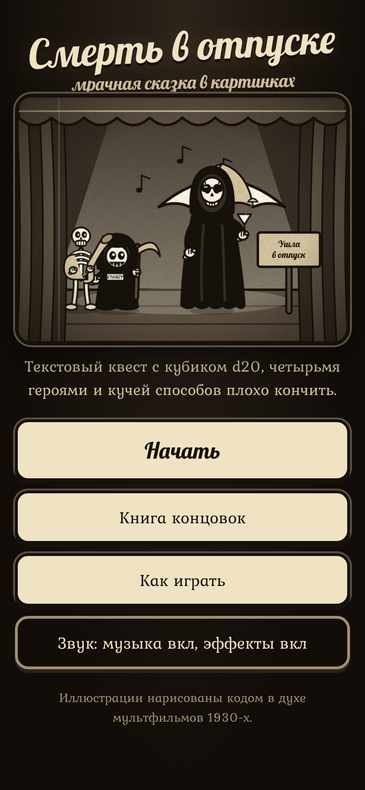
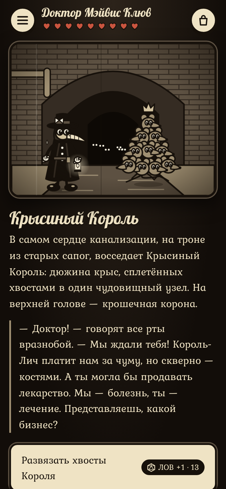
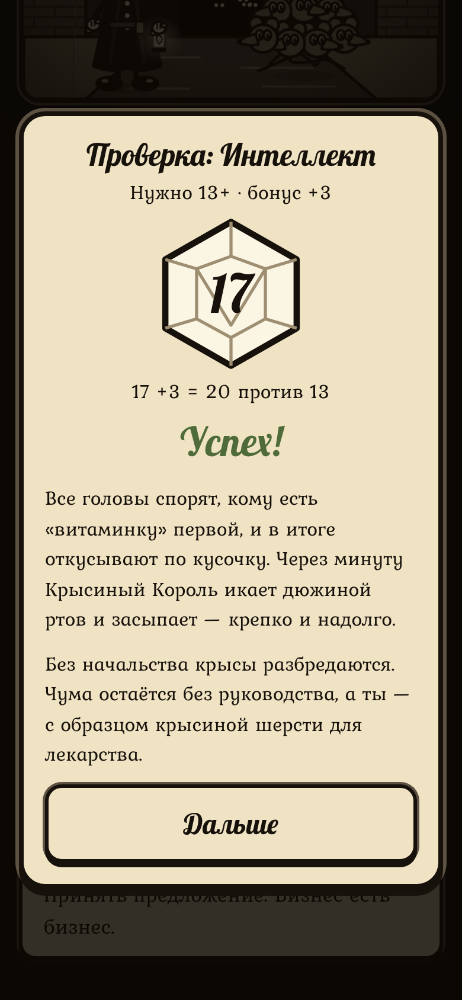

# Смерть в отпуске

Текстовый квест для Android в духе настольных ролевых игр: тёмное фэнтези, много чёрного юмора, кубик d20 и четыре героя. У каждого героя своя история и несколько концовок. Каждая сцена проиллюстрирована в стиле мультфильмов 1930-х годов: руки как резиновые шланги, белые перчатки, глаза-«пирожки» с вырезом, сепия, зерно и царапины старой плёнки.

<p>



</p>

## Сюжет

Три недели назад Король-Лич Мортимер украл у Смерти её косу. С тех пор в долине Гнилодол никто не может умереть. Смерть сидит в таверне «Последний вздох» и пьёт, а её работу кое-как делает стажёр с учебным серпом.

| Герой | Класс | Сильная сторона | Концовок |
|---|---|---|---|
| **Сэр Годфри Безголовый** | рыцарь, голову носит под мышкой | Сила | 5 |
| **Доктор Мэйвис Клюв** | чумной лекарь | Интеллект | 6 |
| **Шныр** | гоблин-вор | Ловкость | 6 |
| **Брат Игнатий** | монах с бесом Пуффом на плече | Харизма | 6 |

Пути героев пересекаются: они встречают одних и тех же персонажей и иногда видят следы друг друга.

## Как играть

- Варианты со значком кубика — это проверки. Бросается d20, к результату прибавляется характеристика героя. Если сумма не меньше сложности, проверка пройдена.
- 20 на кубике — всегда успех, 1 — всегда провал.
- Провалы отнимают здоровье. Когда оно кончается, за героем приходит стажёр Смерти (это тоже концовка).
- Некоторые варианты появляются, только если у героя есть нужный предмет или он раньше что-то узнал.
- Найденные концовки записываются в «Книгу концовок». Игра сохраняется автоматически.

## Установка на Android

APK собирается автоматически при каждом пуше (GitHub Actions, workflow **Android APK**).

1. Откройте вкладку **Actions** → последний успешный запуск **Android APK**.
2. Внизу, в разделе **Artifacts**, скачайте `smert-v-otpuske-apk` (это zip-архив с APK внутри).
3. Распакуйте архив и откройте `smert-v-otpuske.apk` на телефоне. Android попросит разрешить установку из этого источника.

Если отправить тег вида `v1.0`, workflow дополнительно создаст GitHub Release с прикреплённым APK — его удобно скачивать прямо с телефона.

Все сборки подписаны одним и тем же отладочным ключом (`android/debug.keystore`), поэтому новая версия ставится поверх старой, и сохранения не теряются. Для публикации в Google Play нужен собственный секретный ключ.

Требования: Android 8.0 и новее. Интернет не нужен.

## Запуск в браузере

Игра — обычная веб-страница без сборки и зависимостей:

```bash
cd game
python3 -m http.server 8000
# открыть http://localhost:8000
```

## Сборка вручную

- **Android Studio:** откройте папку `android/` и нажмите Run.
- **Командная строка** (нужны JDK 17 и Android SDK):
  ```bash
  cd android
  ./gradlew assembleDebug
  # APK: android/app/build/outputs/apk/debug/app-debug.apk
  ```

## Устройство проекта

```
game/                     игра (HTML5, без зависимостей)
  index.html
  css/style.css           оформление, эффекты киноплёнки, анимации
  js/art.js               SVG-«мультипликатор»: фоны, персонажи, предметы, эффекты
  js/audio.js             синтезированные музыка и звуки (Web Audio)
  js/engine.js            движок: сцены, проверки d20, здоровье, сумка, сохранения
  js/story.js             реестр историй и общая завязка
  js/stories/*.js         истории героев
  fonts/                  шрифты Kurale и Lobster (SIL OFL)
android/                  приложение-обёртка (WebView), берёт game/ как assets
tools/validate-story.js   проверка сюжетов
.github/workflows/        сборка APK
```

### Как устроена сцена

```js
k_gate: {
  title: 'Ворота замка',
  art: { bg: 'castle', fx: ['bats'], items: [['knight', 110, 284, {}], ['skeleton', 260, 280, { spear: true, f: true }]] },
  text: ['Абзац…', '— Реплика начинается с тире и выделяется в тексте.'],
  choices: [
    { t: 'Пробиться силой', check: { stat: 'str', dc: 13 },
      pass: { to: 'k_throne', text: ['…'] },
      fail: { to: 'k_gate', eff: { hp: -3 }, text: ['…'] } },
    { t: 'Через склеп', need: { flag: 'secret_passage' }, to: 'k_crypt' }
  ]
}
```

- `art.items`: фигуры и предметы в формате `[имя, x, y, опции]`. Холст 400×300, `y` — линия, на которой стоят ноги. Опция `s` задаёт масштаб, `f` отражает фигуру. Полный список фонов, фигур и эффектов — в `game/js/art.js` (`BG`, `FIG`, `PROP`, `FX`).
- `eff`: `hp`, `add`/`del` (предметы), `set`/`unset` (флаги), `gold`.
- `need`: `has`/`no` (предметы), `flag`/`noflag`.
- `once: true` — вариант исчезает после первого выбора.
- `say` — текст-результат для выбора без броска.
- `ending: 'id'` превращает сцену в концовку.
- `text`, `art` и `to` могут быть функциями от состояния: `c => c.flag('frog') ? … : …`.

После правок запустите проверку:

```bash
node tools/validate-story.js
```

Скрипт проверяет, что все переходы, предметы и рисунки существуют и каждая концовка достижима. Затем он проигрывает каждого героя 20 000 раз случайными ходами и убеждается, что тупиков нет и все концовки выпадают. Та же проверка выполняется в CI перед сборкой APK.

## Лицензии

Шрифты Kurale и Lobster распространяются по SIL Open Font License (тексты лицензий лежат в `game/fonts/`). Иллюстрации, музыка и тексты созданы для этого проекта.
